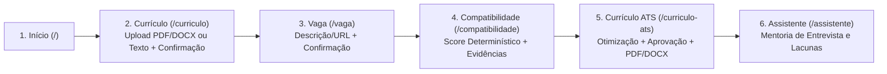
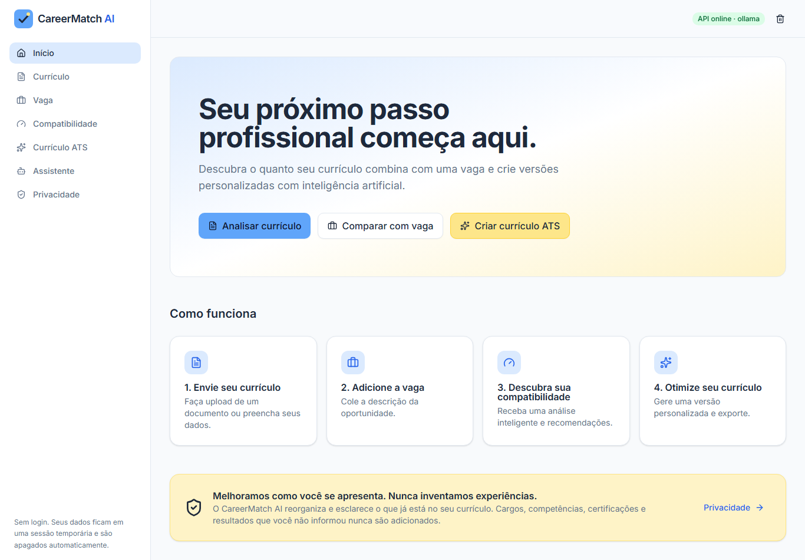
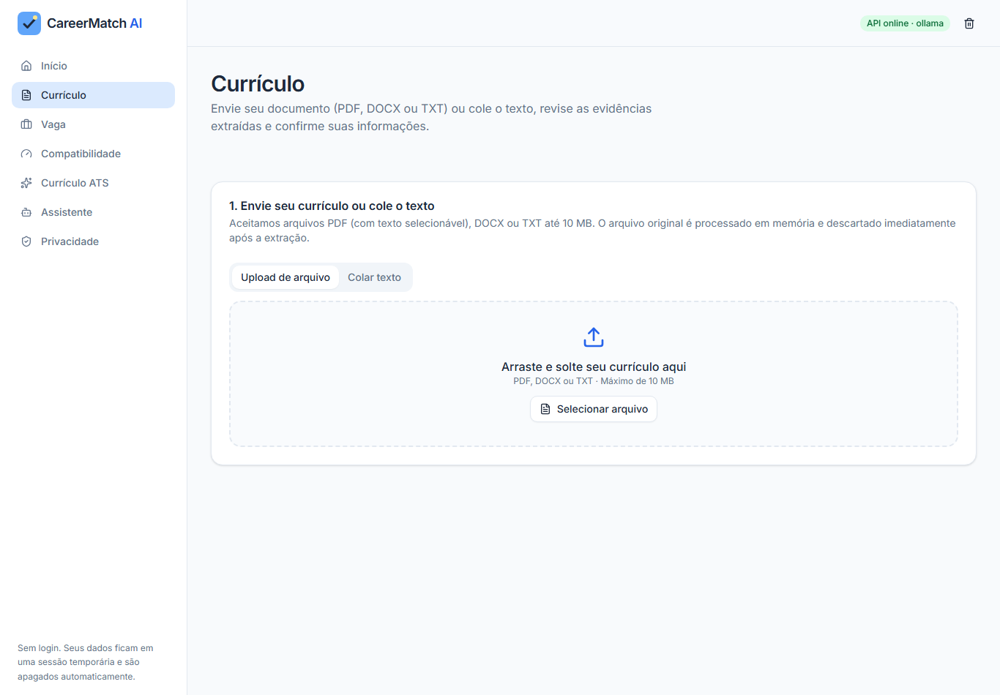
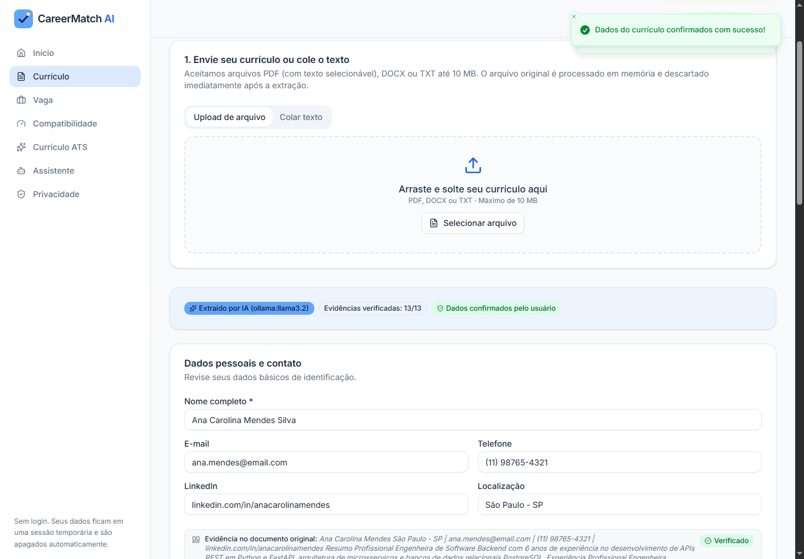
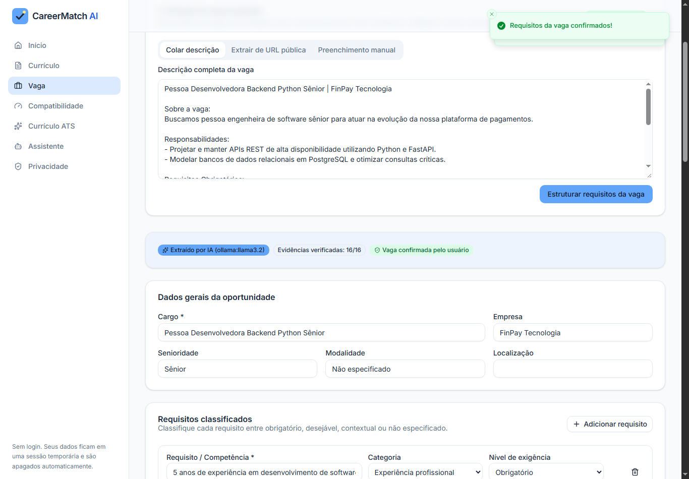
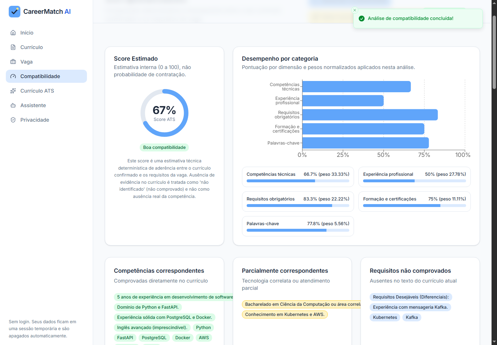
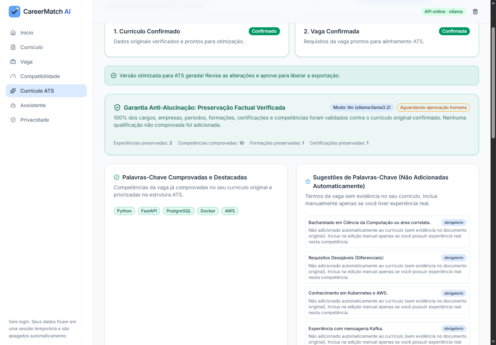
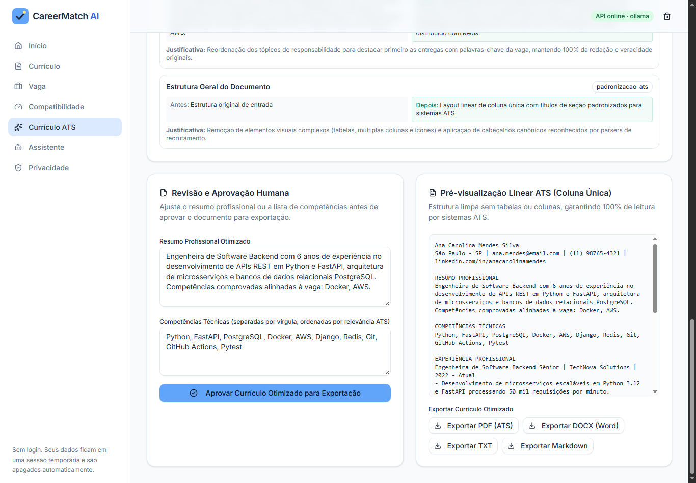
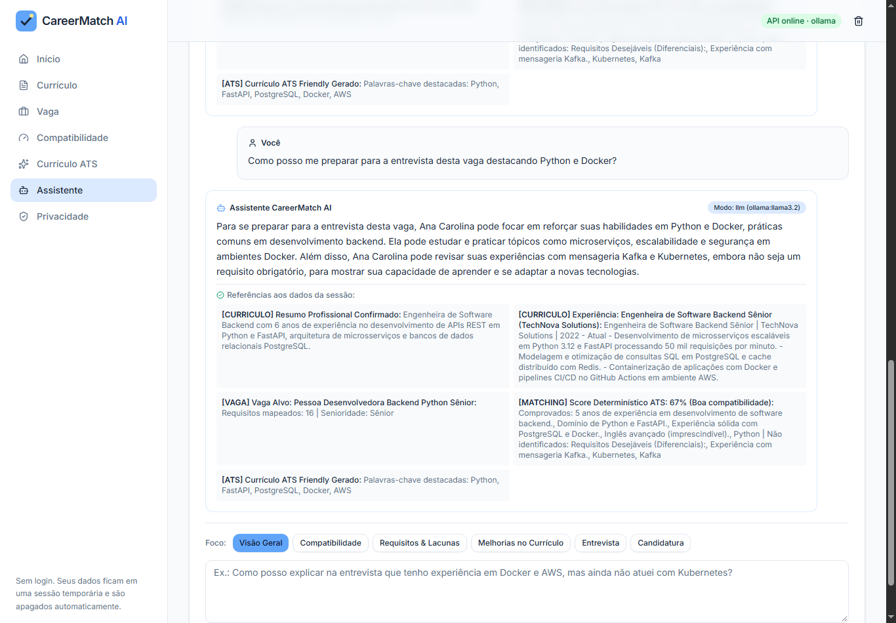

# CareerMatch AI

Plataforma inteligente de análise de compatibilidade entre currículos e vagas (**Matching ATS**), geração de **Currículos ATS Friendly** e **Assistente Contextual de Candidatura**, construída com **React 19 + TypeScript + ShadCN/UI** no frontend e **Python 3.12 + FastAPI + Pydantic v2** no backend, integrada ao **Ollama (`llama3.2`)** para inferência local gratuita e privada.

- **Repositório Oficial no GitHub:** [https://github.com/KamilaRib/-Careermatch-ai](https://github.com/KamilaRib/-Careermatch-ai)
- **Disponibilidade Pública (Deploy):** **Não há URL de deploy público nesta versão.** Por diretriz arquitetural de privacidade (*Privacy by Design* / LGPD) e uso exclusivo de inferência local gratuita com **Ollama (`llama3.2`)**, a aplicação é homologada para execução 100% local.

> **Princípio Inegociável (Zero Fabricação):** O CareerMatch AI melhora a estrutura, a clareza e o alinhamento terminológico das experiências reais da pessoa candidata, mas **nunca inventa** cargos, empresas, períodos, formações, certificações, idiomas ou competências técnicas não comprovadas no documento original.

---

## Sumário

1. [Objetivo e Problema Resolvido](#1-objetivo-e-problema-resolvido)
2. [Arquitetura da Solução](#2-arquitetura-da-solução)
3. [Tecnologias Utilizadas](#3-tecnologias-utilizadas)
4. [Megaprompt Inicial e Evolução dos Prompts por Fases](#4-megaprompt-inicial-e-evolução-dos-prompts-por-fases)
5. [Funcionalidades Implementadas](#5-funcionalidades-implementadas)
6. [Fluxo de Uso da Aplicação](#6-fluxo-de-uso-da-aplicação)
7. [Como o Matching ATS Funciona](#7-como-o-matching-ats-funciona)
8. [Como a Geração de Currículo Evita Alucinações](#8-como-a-geração-de-currículo-evita-alucinações)
9. [Como o Assistente Contextual Funciona](#9-como-o-assistente-contextual-funciona)
10. [Evidências Visuais da Jornada Completa](#10-evidências-visuais-da-jornada-completa)
11. [Instruções Completas de Execução Local](#11-instruções-completas-de-execução-local)
12. [Instruções para Executar os Testes](#12-instruções-para-executar-os-testes)
13. [Limitações Conhecidas e Próximos Passos](#13-limitações-conhecidas-e-próximos-passos)
14. [Documentação Complementar e Licença](#14-documentação-complementar-e-licença)

---

## 1. Objetivo e Problema Resolvido

Candidatos qualificados frequentemente são eliminados na triagem inicial por sistemas *Applicant Tracking System* (ATS) devido a problemas de formatação (layouts em múltiplas colunas, elementos gráficos não legíveis, ausência de termos canônicos exigidos na vaga) ou por desconhecerem quais requisitos obrigatórios e desejáveis precisam ser destacados. Paralelamente, ferramentas genéricas de IA costumam "alucinar" qualificações inexistentes, expondo a pessoa candidata a riscos éticos e reprovações em entrevistas técnicas.

O **CareerMatch AI** resolve esse problema oferecendo uma jornada auditável de ponta a ponta:
- Extrai e valida evidências literais do currículo e da vaga.
- Calcula um score determinístico e transparente de compatibilidade.
- Gera versões de currículo em coluna única compatíveis com sistemas ATS sem adicionar dados não comprovados.
- Orienta a preparação para entrevistas com base exclusiva nos dados confirmados da sessão.

---

## 2. Arquitetura da Solução

A plataforma adota uma arquitetura modular em camadas com **separação estrita entre interpretação assistida por IA e regras de negócio determinísticas**:

```text
careermatch-ai/
├── backend/                     # API RESTful em Python 3.12 + FastAPI + Pydantic v2
│   ├── app/
│   │   ├── ai/                  # Abstração multiprovedor (Ollama, Gemini, OpenAI) e prompts blindados
│   │   ├── api/v1/              # Endpoints REST (/health, /sessions, /resumes, /jobs, /matches, /ats-resume, /assistant)
│   │   ├── core/                # Configuração, sessões em memória (TTL), proteção CSRF, rate limiting e erros
│   │   ├── schemas/             # Contratos estritos Pydantic v2
│   │   ├── security/            # Guardas de segurança (upload_guard.py por magic bytes e ssrf_guard.py)
│   │   └── services/            # Motores determinísticos (matching_engine, ats_generator, evidence_validator, assistant_service)
│   └── tests/                   # 71 testes automatizados (unitários, regressão, segurança e integração)
├── frontend/                    # SPA em React 19 + TypeScript 5.9 + Vite 8 + Tailwind CSS v4 + ShadCN/UI
│   └── src/
│       ├── components/          # Design system reutilizável e layout responsivo
│       ├── hooks/               # Hooks de estado e sincronização com a API
│       ├── pages/               # Páginas das Fases 1 a 6 e 21 testes Vitest/Testing Library
│       ├── services/            # Clientes HTTP com suporte automático a cookies HttpOnly e header X-CSRF-Token
│       └── types/               # Contratos TypeScript espelhados com o backend
└── docs/                        # PRD, arquitetura, referência da API, metodologia ATS, auditoria e evidências
    └── evidencias/              # 8 capturas reais homologadas no navegador Google Chrome
```

---

## 3. Tecnologias Utilizadas

- **Backend:** Python 3.12, FastAPI, Pydantic v2, Uvicorn, HTTPX, PyMuPDF (`fitz`) / `pypdf`, `python-docx`, ReportLab e Pytest.
- **Frontend:** React 19, TypeScript 5.9, Vite 8, Tailwind CSS v4, ShadCN/UI (Radix UI), Lucide Icons, React Router v7, TanStack Query v5, React Hook Form, Zod, Recharts, Vitest e Testing Library.
- **Inteligência Artificial Local:** **Ollama (`0.40.16`)** executando o modelo **`llama3.2`** em `http://localhost:11434` como provedor padrão gratuito, com suporte arquitetural opcional para Google Gemini e OpenAI via variáveis de ambiente e **fallback determinístico automático**.

---

## 4. Megaprompt Inicial e Evolução dos Prompts por Fases

> **Nota de Transparência sobre o Megaprompt Original:** Os requisitos fundacionais concebidos no planejamento inicial do MVP estão documentados em [`docs/01-PRD.md`](docs/01-PRD.md). Caso deseje anexar o texto literal bruto do megaprompt utilizado antes da geração do PRD, basta inseri-lo na seção dedicada de [`docs/01-PRD.md`](docs/01-PRD.md) — em conformidade com a política de veracidade do projeto, nenhum texto de prompt histórico foi inventado.

A engenharia de prompts e de contexto evoluiu de um único prompt conceitual para um pipeline estruturado e verificável dividido em **7 Fases**:

| Fase | Foco da Engenharia de Contexto e Prompts | Artefatos e Guardrails Criados |
|---|---|---|
| **Fase 1 — Fundação e PRD** | Definição das regras inegociáveis de IA (zero fabricação, separação entre dados e instruções, retenção transitória sem login). | [`docs/01-PRD.md`](docs/01-PRD.md), sessões anônimas (`cm_sid`), CSRF double-submit (`cm_csrf`). |
| **Fase 2 — Extração de Currículos** | Prompt estruturado em JSON com delimitadores `<untrusted_resume_text>` contra *Prompt Injection* e exigência de `evidence_quote` literal para cada item. | `resume_prompts.py`, `evidence_validator.py`, correção de truncamento do `professional_summary`. |
| **Fase 3 — Análise de Vagas** | Classificação de requisitos da vaga (`obrigatorio`, `desejavel`, `contextual`, `nao_especificado`) sobre `<untrusted_job_text>` e proteção anti-SSRF em URLs públicas. | `job_prompts.py`, `ssrf_guard.py`, `job_parser.py`. |
| **Fase 4 — Matching ATS Determinístico** | Remoção deliberada do LLM do cálculo de score: o score ATS passou a ser 100% determinístico em Python, auditável e reproduzível. | `matching_engine.py`, `skill_dictionary.py`, dashboard com Recharts. |
| **Fase 5 — Currículo ATS Friendly** | Refinamento de resumo assistido por `ollama:llama3.2` submetido a um guardião determinístico pós-LLM que bloqueia qualquer adição factual não comprovada. | `ats_generator.py`, `verify_and_sanitize_ats_resume`, exportação PDF/DOCX. |
| **Fase 6 — Assistente Contextual** | Prompt compacto ancorado nos artefatos confirmados da sessão (`[CURRICULO]`, `[VAGA]`, `[MATCHING]`, `[ATS]`), sem permissão de escrita sobre o score ATS. | `assistant_prompts.py`, `assistant_service.py`, rota `/assistente`. |
| **Fase 7 — Homologação e Evidências** | Validação ponta a ponta no navegador real com Ollama `llama3.2`, auditoria de segurança/privacidade e consolidação de evidências para a DIO. | [`docs/RELATORIO_HOMOLOGACAO_FASE7.md`](docs/RELATORIO_HOMOLOGACAO_FASE7.md) e [`docs/evidencias/`](docs/evidencias/). |

---

## 5. Funcionalidades Implementadas

1. **Ingestão e Revisão de Currículo (`/curriculo`):**
   - Upload seguro de arquivos `PDF` (com texto selecionável), `DOCX` e `TXT` até 10 MB com validação estrita de *magic bytes* (`upload_guard.py`) ou colagem de texto.
   - Detecção explícita de PDFs escaneados sem camada de texto (`ocr_not_available`).
   - Extração via Ollama (`llama3.2`) com fallback determinístico transparente, validação de evidências literais e confirmação humana obrigatória.
2. **Análise Inteligente de Vagas (`/vaga`):**
   - Entrada via descrição colada, preenchimento manual ou extração de URL pública com bloqueio rigoroso contra SSRF (`ssrf_guard.py` bloqueando IPs privados, loopback, link-local e metadados de nuvem).
   - Identificação de cargo, senioridade, modalidade, responsabilidades e classificação de requisitos com evidências.
3. **Matching ATS e Dashboard (`/compatibilidade`):**
   - Comparação determinística entre currículo confirmado e vaga confirmada.
   - Normalização de sinônimos e variações terminológicas (`skill_dictionary.py`).
   - Gráficos de desempenho por categoria (Recharts), detalhamento de requisitos atendidos, parcialmente atendidos e não identificados, e recomendações acionáveis.
4. **Geração e Exportação de Currículo ATS Friendly (`/curriculo-ats`):**
   - Reordenação de competências comprovadas, alinhamento do resumo profissional, sugestão separada de palavras-chave ausentes (nunca adicionadas automaticamente), histórico de alterações com justificativas, edição/aprovação humana e exportação em **PDF**, **DOCX**, **TXT** e **Markdown**.
5. **Assistente Contextual de Candidatura (`/assistente`):**
   - Chat em português com foco selecionável (*Visão Geral*, *Compatibilidade*, *Requisitos & Lacunas*, *Melhorias no Currículo*, *Entrevista*, *Candidatura*), referências explícitas aos dados da sessão e preservação integral do score ATS.
6. **Privacidade e Descarte Imediato (`/privacidade` e Header):**
   - Isolamento de dados por sessão anônima em memória e botão de descarte imediato (`DELETE /api/v1/sessions/current`).

---

## 6. Fluxo de Uso da Aplicação



---

## 7. Como o Matching ATS Funciona

O cálculo de compatibilidade (`backend/app/services/matching_engine.py`) é **100% determinístico** e aplica os seguintes pesos base documentados em [`docs/matching-methodology.md`](docs/matching-methodology.md):

| Categoria | Peso Base | Regra de Renormalização |
|---|---|---|
| **Competências Técnicas (`tecnico`)** | `30%` | Quando uma categoria não possui itens na vaga (ex.: nenhuma competência comportamental listada), seu peso é redistribuído proporcionalmente entre as categorias aplicáveis. |
| **Experiência Profissional (`experiencia`)** | `25%` | Avalia anos mínimos exigidos e aderência das responsabilidades. |
| **Requisitos Obrigatórios (`obrigatorios`)** | `20%` | Avalia o percentual de atendimento estrito dos itens classificados como `obrigatorio`. |
| **Formação e Certificações (`formacao`)** | `10%` | Avalia graduação e certificações exigidas ou desejáveis. |
| **Competências Comportamentais (`comportamental`)** | `10%` | Avalia *soft skills* explícitas na vaga. |
| **Palavras-Chave (`palavras_chave`)** | `5%` | Avalia cobertura terminológica geral da oportunidade. |

### Estados de Avaliação e Regra sobre Tecnologias Correlatas
- Cada requisito recebe um dos 5 estados: `atendido` (`1.0`), `parcialmente_atendido` (`0.5`), `nao_identificado` (`0.0`), `nao_atendido` (`0.0`) ou `nao_avaliavel` (neutro).
- **Regra Estrita sobre Tecnologias Correlatas:** Experiência comprovada em tecnologias correlatas (como `Docker` e `AWS`) **não comprova** conhecimento em uma tecnologia específica ausente no currículo (como `Kubernetes`). O requisito permanece classificado como `nao_identificado` (`credit = 0.0`), gerando apenas uma recomendação consultiva para que a pessoa candidata adicione a competência manualmente caso possua experiência real.

---

## 8. Como a Geração de Currículo Evita Alucinações

O módulo `/curriculo-ats` (`backend/app/services/ats_generator.py`) aplica uma defesa em profundidade (**Guardrail Determinístico Pós-LLM**) através da função `verify_and_sanitize_ats_resume`:

1. **Imutabilidade Estrutural de Histórico:** As listas de experiências profissionais (`experiences`), formações acadêmicas (`education`), certificações (`certifications`), idiomas (`languages`) e dados pessoais (`personal_info`) são copiadas diretamente do currículo original confirmado pelo usuário, impedindo que o LLM invente cargos, empresas ou datas.
2. **Filtro de Competências Comprovadas:** Apenas competências presentes no currículo confirmado são mantidas e reordenadas por relevância para a vaga. Qualquer tentativa de injeção de requisito não comprovado (como `Kubernetes` ou `Kafka`) é descartada e movida para a lista consultiva `suggested_keywords_for_manual_review`.
3. **Inspeção Anti-Alucinação do Resumo Profissional:** Quando o Ollama (`llama3.2`) reescreve o resumo profissional, o validador verifica se o texto gerado menciona alguma lacuna não comprovada da vaga ou perde os fatos originais. Caso detecte qualquer termo não comprovado, o resumo do LLM é rejeitado automaticamente e substituído pela síntese determinística verificada.
4. **Aprovação Humana Obrigatória:** Os endpoints de exportação (`/api/v1/ats-resume/export/{pdf|docx|txt|md}`) retornam `HTTP 422 (ats_resume_not_approved)` enquanto o usuário não revisar e clicar em **"Aprovar Currículo Otimizado para Exportação"**.

---

## 9. Como o Assistente Contextual Funciona

O Assistente de Candidatura (`/assistente`, implementado em `backend/app/services/assistant_service.py`) opera sobre o contexto real confirmado na sessão:
- **Ancoragem em Evidências (`Citations`):** Toda resposta é acompanhada de cartões de referência rastreáveis (`[CURRICULO]`, `[VAGA]`, `[MATCHING]`, `[ATS]`) extraídos diretamente da sessão ativa.
- **Proteção Somente Leitura do Score ATS:** O endpoint `POST /api/v1/assistant/chat` lê o `MatchingResult` da sessão, mas **nunca altera** o score ou o estado dos requisitos antes, durante ou após a conversa.
- **Declaração Explícita de Limitações:** Quando o usuário pergunta sobre requisitos sem evidência no currículo (ex.: `Kubernetes` ou `Kafka`) ou tenta usar o chat sem ter confirmado o currículo e a vaga, o assistente informa explicitamente a limitação factual e orienta os próximos passos legítimos.

---

## 10. Evidências Visuais da Jornada Completa

Todas as evidências abaixo foram capturadas em navegador **Google Chrome real** durante a homologação da Fase 7 e encontram-se no diretório [`docs/evidencias/`](docs/evidencias/):

### 10.1. Página Inicial (`/`) com Backend e Ollama Online


### 10.2. Upload Seguro de Currículo (`/curriculo`)


### 10.3. Revisão, Validação de Evidências (`ollama:llama3.2`) e Confirmação do Currículo


### 10.4. Análise Inteligente da Vaga (`ollama:llama3.2`) e Confirmação de Requisitos (`/vaga`)


### 10.5. Dashboard de Compatibilidade ATS e Lacunas Não Comprovadas (`/compatibilidade`)


### 10.6. Currículo ATS Otimizado com Selo Anti-Alucinação (`/curriculo-ats`)


### 10.7. Revisão Humana, Pré-visualização Linear em Coluna Única e Exportação PDF/DOCX


### 10.8. Assistente Contextual com Ollama (`llama3.2`), Citações e Score ATS Preservado (`/assistente`)


---

## 11. Instruções Completas de Execução Local

### Pré-requisitos
- **Python 3.12+**
- **Node.js 20+**
- **[Ollama](https://ollama.com/)** instalado localmente com o modelo `llama3.2`:
  ```powershell
  ollama pull llama3.2
  ollama list
  ```
  *(Caso o Ollama não esteja em execução, a aplicação continuará funcionando integralmente por meio do fallback determinístico automático).*

### Passo 1 — Configurar Variáveis de Ambiente
Na raiz do projeto (`careermatch-ai/`), copie o arquivo `.env.example` para `.env`:
```powershell
Copy-Item .env.example .env
```

### Passo 2 — Iniciar o Backend (FastAPI na porta `8000`)
```powershell
cd backend
python -m venv .venv
.\.venv\Scripts\python -m pip install -r requirements.txt
.\.venv\Scripts\python -m uvicorn app.main:app --host 127.0.0.1 --port 8000
```

### Passo 3 — Iniciar o Frontend (React + Vite na porta `5173`)
Em um segundo terminal:
```powershell
cd frontend
npm.cmd install
npm.cmd run dev -- --host 127.0.0.1 --port 5173
```

- **Interface Web:** `http://localhost:5173`
- **Swagger / OpenAPI:** `http://localhost:8000/api/docs`
- **Healthcheck:** `http://localhost:8000/api/v1/health`

---

## 12. Instruções para Executar os Testes

### Testes Automatizados do Backend (71 testes com Pytest)
```powershell
cd backend
.\.venv\Scripts\python -m pytest -v
```

### Testes Automatizados do Frontend (21 testes com Vitest + TypeScript + Build)
```powershell
cd frontend
npm.cmd test
npx.cmd tsc -b
npm.cmd run build
```

---

## 13. Limitações Conhecidas e Próximos Passos

1. **Ausência de Deploy Público nesta Versão:** O sistema foi projetado para rodar localmente conectado ao servidor **Ollama (`localhost:11434`)**, garantindo custo zero de inferência e retenção zero de dados pessoais em servidores de terceiros.
2. **Latência do Ollama em CPU:** Em máquinas sem GPU dedicada (`VRAM = 0`), a inferência estruturada com `llama3.2` leva entre 25 e 65 segundos por chamada. O timeout padrão foi dimensionado para `180s` (`AI_TIMEOUT_SECONDS=180.0`) e todas as telas oferecem alternância imediata para o modo determinístico (`< 50ms`).
3. **Vagas em Portais SPA Autenticados:** O extrator de URL pública (`POST /api/v1/jobs/extract-url`) bloqueia SSRF e analisa HTML estático sem executar JavaScript remoto. Para vagas em portais fechados (LinkedIn, Gupy, Workday), utilize a aba **"Colar descrição"**.
4. **PDFs Escaneados sem OCR:** Documentos PDF compostos apenas por imagens digitalizadas são rejeitados com a mensagem orientativa `ocr_not_available`.
5. **Próximos Passos Evolutivos:** Suporte opcional a OCR local (Tesseract), histórico comparativo de múltiplas vagas exportável em JSON local e suíte Playwright em pipeline CI.

---

## 14. Documentação Complementar e Licença

- [Product Requirements Document — PRD Inicial](docs/01-PRD.md)
- [Arquitetura do Sistema](docs/architecture.md)
- [Referência Completa da API REST v1](docs/api.md)
- [Metodologia de Compatibilidade ATS](docs/matching-methodology.md)
- [Privacidade, Segurança e LGPD](docs/privacy.md)
- [Relatório de Auditoria Pré-Publicação](docs/AUDITORIA_PRE_PUBLICACAO.md)
- [Relatório Final de Homologação — Fase 7](docs/RELATORIO_HOMOLOGACAO_FASE7.md)
- Distribuído sob a [Licença MIT](LICENSE).
