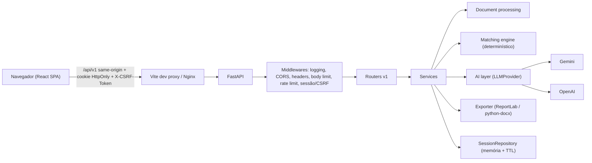

# Arquitetura

## Visão geral

## Backend (`backend/app`)

| Pacote | Responsabilidade |
|---|---|
| `main.py` | Factory `create_app(settings)`, middlewares, lifespan (limpeza periódica de sessões) |
| `core/` | Configuração validada (`pydantic-settings`), logging JSON, erros padronizados, observabilidade |
| `api/v1/` | Routers versionados |
| `schemas/` | Contratos Pydantic de entrada/saída |
| `domain/` | Modelos e regras de negócio puras |
| `services/` | Casos de uso (parsers, matching, otimizador, assistente, exportador) |
| `ai/providers` | Interface `LLMProvider` + implementações Gemini/OpenAI |
| `ai/prompts` | Templates de prompt versionados |
| `ai/validators` | Validação de saídas da IA e verificação anti-fabricação |
| `repositories/` | `SessionRepository` (in-memory agora, PostgreSQL/Supabase no futuro) |
| `security/` | Sessão + CSRF, rate limit, limite de payload, headers, SSRF guard |

### Ordem dos middlewares (de fora para dentro)
`RequestLogging → CORS → SecurityHeaders → BodySizeLimit → RateLimit → Session/CSRF → Router`

## Frontend (`frontend/src`)

| Pasta | Responsabilidade |
|---|---|
| `app/` | Rotas, providers (React Query, Tooltip, Toaster), navegação |
| `components/ui` | Primitivas ShadCN/UI |
| `components/layout` | Sidebar, Header, AppLayout, PageHeader |
| `components/{resume,jobs,matching,assistant}` | Componentes de domínio |
| `pages/` | Páginas roteadas |
| `hooks/` | Hooks de dados (React Query) |
| `services/` | Chamadas à API por domínio |
| `lib/` | Cliente HTTP (CSRF, erros), utils |
| `types/`, `schemas/` | Tipos TS e schemas Zod |

## Decisões técnicas

1. **Proxy same-origin:** o browser só fala com `/api`. Os cookies são first-party, o CSRF fica simples e nenhuma chave de IA chega ao cliente.
2. **Sessão anônima:** ID de 256 bits em cookie HttpOnly, SameSite=Lax e Secure em produção. A expiração é deslizante e um job em background faz a limpeza.
3. **CSRF double-submit:** o cookie `cm_csrf` (legível) precisa ser ecoado no header `X-CSRF-Token`, comparado em tempo constante com o valor no servidor.
4. **IA interpreta, backend calcula:** o score é determinístico e reprodutível (ver `matching-methodology.md`).
5. **Anti-fabricação:** toda saída otimizada passa por um validador que compara com os dados confirmados pelo usuário.
6. **Tailwind v4 + tokens ShadCN:** a paleta fica em CSS variables (`src/styles/globals.css`). Cores claras (azul/amarelo) sempre usam texto escuro para manter contraste AA.
7. **Sem banco no MVP:** a interface de repositório deixa a troca de persistência isolada.
