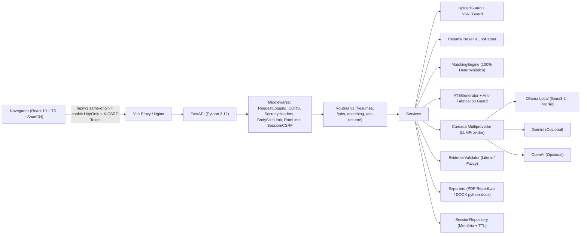

# Arquitetura — CareerMatch AI

## Visão Geral

## Backend (`backend/app`)

| Módulo | Responsabilidade |
|---|---|
| `main.py` | Factory `create_app(settings)`, registro de middlewares e limpeza periódica de sessões (`lifespan`) |
| `core/` | Configurações validadas (`pydantic-settings`), logging JSON estruturado (sem PII), erros padronizados |
| `api/v1/` | Endpoints REST (`health`, `sessions`, `resumes`, `jobs`, `matching`, `ats_resume`) |
| `schemas/` | Contratos Pydantic v2 (`resume.py`, `job.py`, `matching.py`, `ats_resume.py`, `common.py`) |
| `services/` | Regras de negócio: `resume_parser.py`, `job_parser.py`, `matching_engine.py`, `ats_generator.py` |
| `ai/providers/` | Protocolo `LLMProvider` + implementações `OllamaProvider` (padrão local), `GeminiProvider` e `OpenAIProvider` |
| `ai/prompts/` | Prompts estruturados com isolamento de entradas não confiáveis (`<untrusted_resume_text>`, `<untrusted_job_text>`) |
| `ai/validators/` | `evidence_validator.py`: verifica se cada item extraído possui comprovação literal no documento de origem |
| `repositories/` | `InMemorySessionRepository` com isolamento por sessão e expiração automática por TTL |
| `security/` | `upload_guard.py`, `ssrf_guard.py`, `session.py` (HttpOnly + CSRF double-submit), `rate_limit.py`, `middleware.py` |

## Frontend (`frontend/src`)

| Pasta | Responsabilidade |
|---|---|
| `app/` | Roteamento (`routes.tsx`), provedores (`providers.tsx`) e shell principal (`App.tsx`) |
| `components/ui/` | Componentes base ShadCN/UI + Radix + Tailwind CSS v4 |
| `components/layout/` | `AppLayout`, `Header` (com indicador de status da API/IA e botão "Limpar meus dados"), `Sidebar` |
| `components/resume/` | `ResumeUploadCard` (drag-and-drop) e `ResumeReviewForm` (React Hook Form + Zod) |
| `pages/` | `HomePage`, `ResumePage` (`/curriculo`), `JobPage` (`/vaga`), `MatchPage` (`/compatibilidade`), `OptimizePage` (`/curriculo-ats`), `PrivacyPage` (`/privacidade`) |
| `hooks/` | `useResume`, `useJob`, `useMatching`, `useATSResume` |
| `services/` | Clientes de domínio consumindo `src/lib/api.ts` |
| `types/` e `schemas/` | Tipagens TypeScript estritas e validações Zod |
